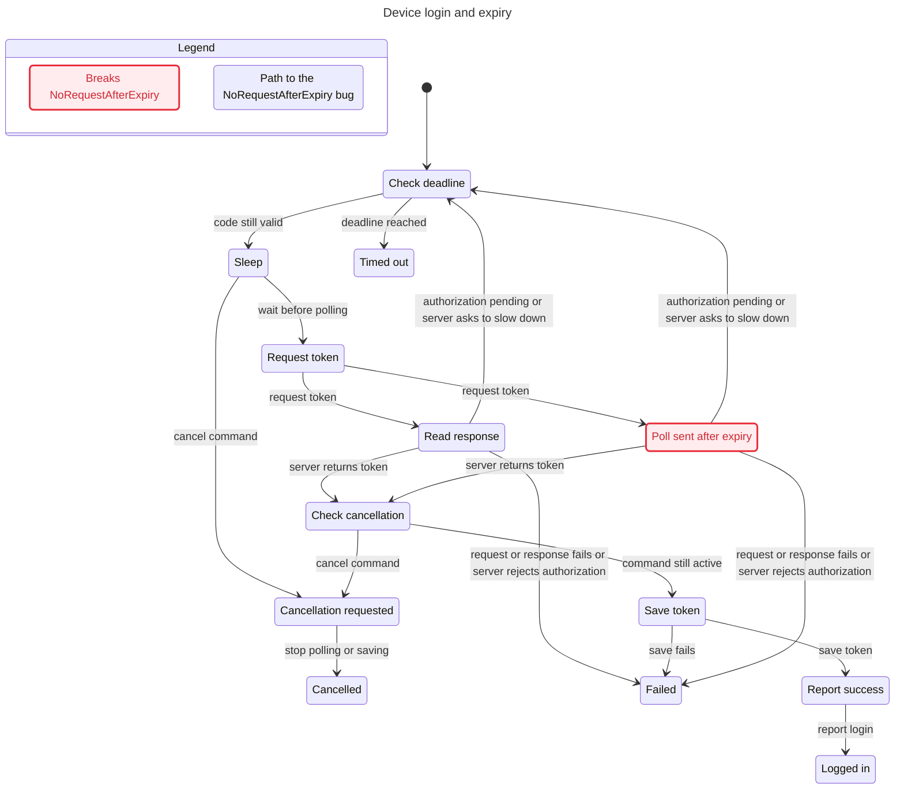
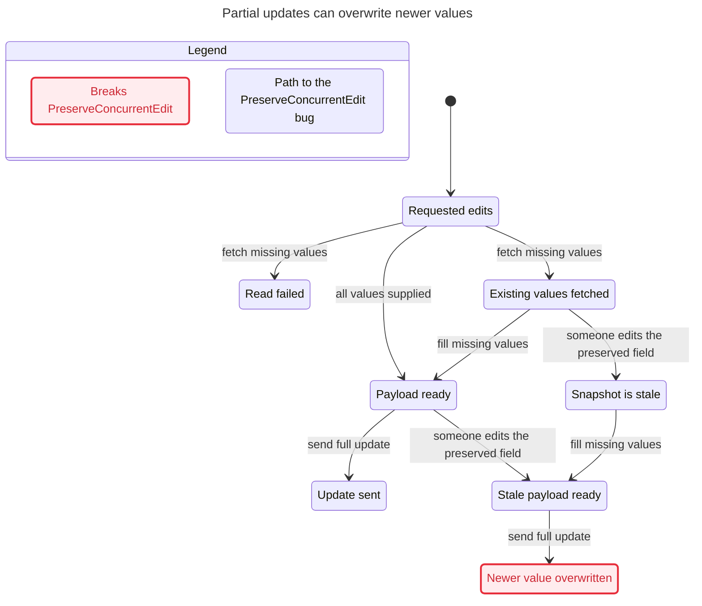
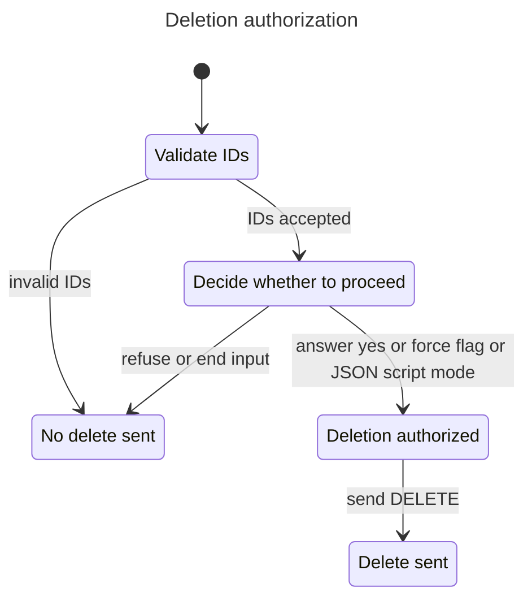
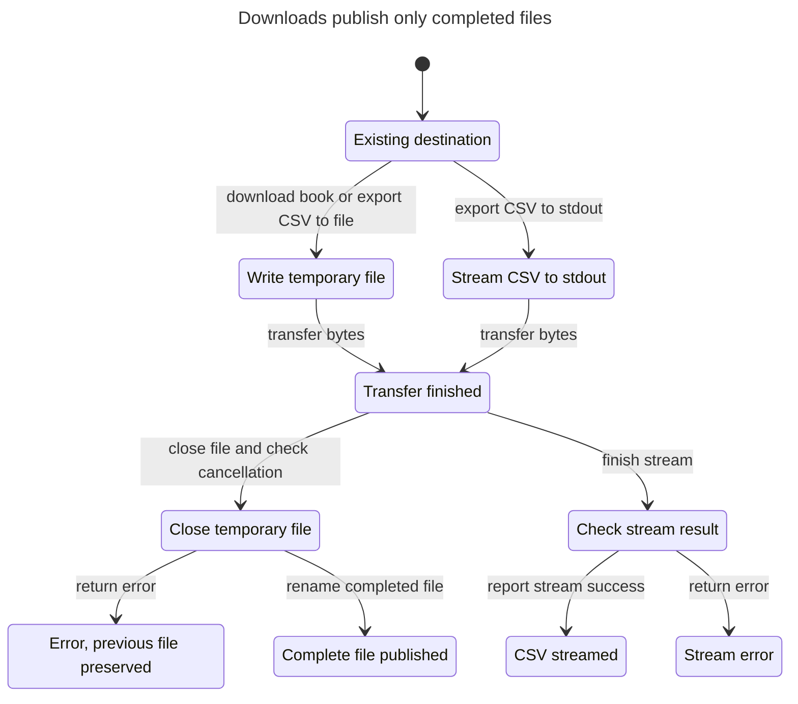

# Checked user flows

These diagrams were generated with the statechart skill from the refreshed models at source commit `14b3363`. TLC 2.19 exhausts each finite graph. The diagrams combine states with the same user-visible meaning and hide terminal stuttering. They retain each state on the selected counterexample paths.

## Device login

NoRequestAfterExpiry asks that token requests start before expiry. The shortest counterexample has steps 0 through 7. A pending response leads back to the deadline check, the second wait crosses expiry, and the next request starts. A Go replay follows this sequence against a local HTTP server. Cancellation now stops waiting and is checked before saving.

Regenerate with `/statechart` using `models/auth/AuthPoll.tla`, configuration `models/auth/AuthPoll.finding-expiry.cfg`, and `views/auth.mjs`. Choose a new output directory.

## Partial updates

PreserveConcurrentEdit asks that an omitted field keep a concurrent writer's value. The shortest counterexample has steps 0 through 4. Fetch the old value, allow another writer to change it, merge the old value, then PUT it. Link and newsletter replays send stale values. Data loss assumes a server accepting unversioned last-write-wins PUT.

Regenerate with `/statechart` using `models/mutations/ReadMergeWrite.tla`, configuration `models/mutations/ReadMergeWrite.finding.cfg`, and `views/merge.mjs`. Choose a new output directory.

## Deletion authorization

AuthorizedDelete holds. Invalid IDs prevent DELETE. Valid IDs require force, JSON mode, or an affirmative answer. Refusal and EOF cancel. JSON mode authorizes deletion under the implemented policy.

Regenerate with `/statechart` using `models/mutations/DeleteGate.tla`, configuration `models/mutations/DeleteGate.cfg`, and `views/delete.mjs`. Choose a new output directory.

## Download publication

FailurePreservesDestination and PublicationAfterClose hold. Book downloads and CSV exports write temporary files and rename only after successful transfer and close. CSV exports also check cancellation before rename. Existing files survive failure. Stdout streams bytes directly, reports short writes as errors, and cannot roll back emitted bytes.

Regenerate with `/statechart` using `models/io/Download.tla`, configuration `models/io/Download.cfg`, and `views/download.mjs`. Choose a new output directory.

## Scope

Login starts after the device code is decoded. Updates abstract HTTP errors and field values. Deletion ends at dispatch. Downloads abstract byte contents and filesystem outcomes. The charts do not prove filesystem durability, production server persistence, dependency internals, or liveness under arbitrary scheduling. Read [coverage.md](coverage.md) and the source maps for full bounds.
